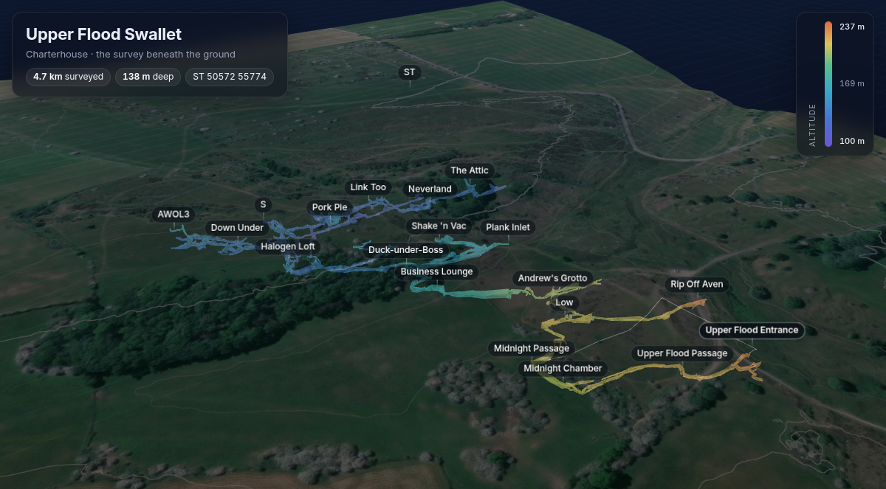
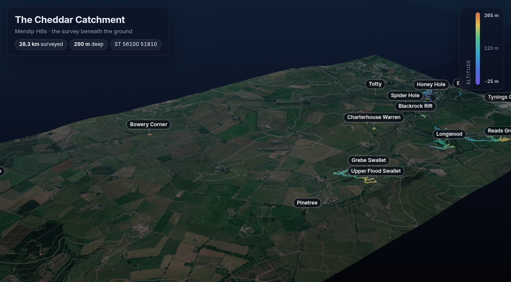

# The Cheddar Catchment

[](https://cavesurveying.github.io/gb.mendips.cheddar-catchment/)

## **[Open the site →](https://cavesurveying.github.io/gb.mendips.cheddar-catchment/)**

The surveys of the caves that drain to Cheddar, on Mendip, Somerset:
Gough's Cave, GB, Charterhouse, Upper Flood, Reservoir Hole, the Longwood
caves and over forty more, about **28 km** surveyed in all. The site shows them
in 3D under the ground surface, gives each of the bigger caves a page of its
own, and has the plans to print and the data to download. It's rebuilt from
this repository every time it changes.

| On the site | |
|---|---|
| [The whole catchment in 3D](https://cavesurveying.github.io/gb.mendips.cheddar-catchment/3d/) | Every survey together under the Environment Agency's LiDAR and aerial imagery, with every entrance named. Add `#at=` and a survey's name to open it on one cave, e.g. [`3d/#at=UpperFlood`](https://cavesurveying.github.io/gb.mendips.cheddar-catchment/3d/#at=UpperFlood). |
| [Charterhouse Cave](https://cavesurveying.github.io/gb.mendips.cheddar-catchment/charterhouse/) | 5.2 km surveyed, 228 m deep. |
| [Upper Flood Swallet](https://cavesurveying.github.io/gb.mendips.cheddar-catchment/upper-flood/) | 4.7 km surveyed, 138 m deep. |
| [Gough's Cave](https://cavesurveying.github.io/gb.mendips.cheddar-catchment/goughs/) | 3.4 km surveyed, 116 m deep. |
| [GB Cave](https://cavesurveying.github.io/gb.mendips.cheddar-catchment/gb/) | 2.5 km surveyed, 138 m deep. |
| [Reservoir Hole](https://cavesurveying.github.io/gb.mendips.cheddar-catchment/reservoir/) | 2.2 km surveyed, 131 m deep. |
| [Longwood Valley Sink](https://cavesurveying.github.io/gb.mendips.cheddar-catchment/longwood-valley-sink/) | 1.7 km surveyed, 130 m deep. |
| [Longwood Swallet](https://cavesurveying.github.io/gb.mendips.cheddar-catchment/longwood/) | 1.4 km surveyed, 177 m deep. |
| [Wigmore Swallet](https://cavesurveying.github.io/gb.mendips.cheddar-catchment/wigmore/) | 1.0 km surveyed, 100 m deep. |
| [Bone Hole](https://cavesurveying.github.io/gb.mendips.cheddar-catchment/bone-hole/) | 0.4 km surveyed, 37 m deep. |
| Models and data | On each cave's page: Survex `.3d` for Aven, Therion `.lox` for Loch, the plan as PDF and SVG, KML for Google Earth, and Therion's survey, cave and continuation lists. |

Each cave's page has its figures, its 3D view (with passage walls from the
drawings, the drawn plan and routes through the cave where there are
them), the plan to print and its data. The 3D views work offline once
opened. They also work in AR on an iPhone or iPad, and in AR or VR in any
browser that supports WebXR, such as on an Android phone or a headset.

[](https://cavesurveying.github.io/gb.mendips.cheddar-catchment/3d/)

## Where the data comes from

This is a copy of the Cave Registry Data Archive's **CheddarCatchment**
Therion and Survex surveys, with their history. **The source of truth is
the SVN repository, <https://www.cave-registry.org.uk/svn/CheddarCatchment/>:**
that's where the surveys are worked on and where changes go, so don't make
survey changes here. The surveys' credits and licences are as their own
files give them.

## The caves

By surveyed length (Therion's figures, including duplicate legs but not surface ones).
**Bold** caves have a page of their own. *Drawn*: there are Therion drawings
(`.th2`) for it, which give the passage walls in 3D (and the 2D plan on its own
page). *Splays*: the survey has splay shots, shown faintly in 3D.

| Cave | Length | Depth | Its own page | In the catchment 3D | Drawn | Splays | Data |
|---|--:|--:|---|---|:-:|:-:|---|
| **Charterhouse Cave** | 5,218 m | 228 m | [page](https://cavesurveying.github.io/gb.mendips.cheddar-catchment/charterhouse/) | [show](https://cavesurveying.github.io/gb.mendips.cheddar-catchment/3d/#at=Charterhouse) | ✓ | ✓ | [`Charterhouse/`](Charterhouse/) |
| **Upper Flood Swallet** | 4,725 m | 138 m | [page](https://cavesurveying.github.io/gb.mendips.cheddar-catchment/upper-flood/) | [show](https://cavesurveying.github.io/gb.mendips.cheddar-catchment/3d/#at=UpperFlood) | ✓ | ✓ | [`UpperFlood/`](UpperFlood/) |
| **Gough's Cave** | 3,440 m | 116 m | [page](https://cavesurveying.github.io/gb.mendips.cheddar-catchment/goughs/) | [show](https://cavesurveying.github.io/gb.mendips.cheddar-catchment/3d/#at=Goughs) | ✓ | ✓ | [`Goughs/`](Goughs/) |
| **GB Cave** | 2,533 m | 138 m | [page](https://cavesurveying.github.io/gb.mendips.cheddar-catchment/gb/) | [show](https://cavesurveying.github.io/gb.mendips.cheddar-catchment/3d/#at=GB) | ✓ | ✓ | [`GB/`](GB/) |
| **Reservoir Hole** | 2,236 m | 131 m | [page](https://cavesurveying.github.io/gb.mendips.cheddar-catchment/reservoir/) | [show](https://cavesurveying.github.io/gb.mendips.cheddar-catchment/3d/#at=Reservoir) | ✓ | ✓ | [`Reservoir/`](Reservoir/) |
| **Longwood Valley Sink** | 1,731 m | 130 m | [page](https://cavesurveying.github.io/gb.mendips.cheddar-catchment/longwood-valley-sink/) | [show](https://cavesurveying.github.io/gb.mendips.cheddar-catchment/3d/#at=LongwoodValleySink) | ✓ | ✓ | [`LongwoodValleySink/`](LongwoodValleySink/) |
| **Longwood Swallet** | 1,444 m | 177 m | [page](https://cavesurveying.github.io/gb.mendips.cheddar-catchment/longwood/) | [show](https://cavesurveying.github.io/gb.mendips.cheddar-catchment/3d/#at=Longwood) | ✓ |  | [`Longwood/`](Longwood/) |
| Tyning's Barrows Swallet | 1,094 m | 130 m |  | [show](https://cavesurveying.github.io/gb.mendips.cheddar-catchment/3d/#at=TyningsBarrow) | ✓ |  | [`TyningsBarrow/`](TyningsBarrow/) |
| **Wigmore Swallet** | 961 m | 100 m | [page](https://cavesurveying.github.io/gb.mendips.cheddar-catchment/wigmore/) | [show](https://cavesurveying.github.io/gb.mendips.cheddar-catchment/3d/#at=Wigmore) |  |  | [`Wigmore/`](Wigmore/) |
| Buddles Wood (Chewton Mendip) | 731 m | 35 m |  | [show](https://cavesurveying.github.io/gb.mendips.cheddar-catchment/3d/#at=Buddles) | ✓ | ✓ | [`ChewtonMendip/`](ChewtonMendip/) |
| **Bone Hole** | 438 m | 37 m | [page](https://cavesurveying.github.io/gb.mendips.cheddar-catchment/bone-hole/) | [show](https://cavesurveying.github.io/gb.mendips.cheddar-catchment/3d/#at=BoneHole) | ✓ | ✓ | [`BoneHole/`](BoneHole/) |
| Long Hole | 315 m | 31 m |  | [show](https://cavesurveying.github.io/gb.mendips.cheddar-catchment/3d/#at=LongHole) | ✓ | ✓ | [`LongHole/`](LongHole/) |
| Attborough Swallet | 307 m | 41 m |  | [show](https://cavesurveying.github.io/gb.mendips.cheddar-catchment/3d/#at=Attborough) |  |  | [`Attborough/`](Attborough/) |
| Waterwheel Swallet | 301 m | 64 m |  | [show](https://cavesurveying.github.io/gb.mendips.cheddar-catchment/3d/#at=Waterwheel) |  |  | [`Waterwheel/`](Waterwheel/) |
| Grebe Swallet | 296 m | 53 m |  | [show](https://cavesurveying.github.io/gb.mendips.cheddar-catchment/3d/#at=Grebe_Swallet) | ✓ | ✓ | [`Grebe/`](Grebe/) |
| Great Oones Hole | 257 m | 37 m |  | [show](https://cavesurveying.github.io/gb.mendips.cheddar-catchment/3d/#at=GreatOones) | ✓ | ✓ | [`GreatOones/`](GreatOones/) |
| Rhino Rift | 253 m | 147 m |  | [show](https://cavesurveying.github.io/gb.mendips.cheddar-catchment/3d/#at=RRift) | ✓ |  | [`RRift/`](RRift/) |
| Charterhouse Warren Farm Swallet | 209 m | 49 m |  | [show](https://cavesurveying.github.io/gb.mendips.cheddar-catchment/3d/#at=CharterhouseWarren) | ✓ | ✓ | [`CharterhouseWarren/`](CharterhouseWarren/) |
| Spider Hole | 179 m | 102 m |  | [show](https://cavesurveying.github.io/gb.mendips.cheddar-catchment/3d/#at=SpiderHole) | ✓ | ✓ | [`Spider/`](Spider/) |
| Gough's Old Cave | 154 m | 27 m |  | [show](https://cavesurveying.github.io/gb.mendips.cheddar-catchment/3d/#at=GoughsOld) | ✓ | ✓ | [`GoughsOld/`](GoughsOld/) |
| Cox's Cave | 149 m | 5 m |  | [show](https://cavesurveying.github.io/gb.mendips.cheddar-catchment/3d/#at=Coxs) | ✓ | ✓ | [`Coxs/`](Coxs/) |
| Box Cave | 132 m | 27 m |  | [show](https://cavesurveying.github.io/gb.mendips.cheddar-catchment/3d/#at=BoxCave) | ✓ |  | [`BoxCave/`](BoxCave/) |
| Whitebeam area (Whitebeam, Swine Hole, Brock) | 109 m | 16 m |  | [show](https://cavesurveying.github.io/gb.mendips.cheddar-catchment/3d/#at=WhitebeamArea) | ✓ | ✓ | [`WhitebeamArea/`](WhitebeamArea/) |
| Stainsby's Shaft | 105 m | 32 m |  | [show](https://cavesurveying.github.io/gb.mendips.cheddar-catchment/3d/#at=Blackmoor) |  |  | [`Blackmoor/`](Blackmoor/) |
| Dave Mitchell's Dig | 102 m | 75 m |  | [show](https://cavesurveying.github.io/gb.mendips.cheddar-catchment/3d/#at=DaveMitchellsDig) | ✓ | ✓ | [`DaveMitchellsDig/`](DaveMitchellsDig/) |
| Chelms Combe | 101 m | 25 m |  | [show](https://cavesurveying.github.io/gb.mendips.cheddar-catchment/3d/#at=ChelmsCombe) | ✓ | ✓ | [`ChelmsCombe/`](ChelmsCombe/) |
| Canyon Cave | 88 m | 17 m |  | [show](https://cavesurveying.github.io/gb.mendips.cheddar-catchment/3d/#at=CanyonCave) | ✓ | ✓ | [`CanyonCave/`](CanyonCave/) |
| Bowery Corner | 85 m | 7 m |  | [show](https://cavesurveying.github.io/gb.mendips.cheddar-catchment/3d/#at=BoweryCorner) | ✓ | ✓ | [`BoweryCorner/`](BoweryCorner/) |
| Tynings Great Swallet | 78 m | 37 m |  | [show](https://cavesurveying.github.io/gb.mendips.cheddar-catchment/3d/#at=TyningsGS) | ✓ | ✓ | [`TyningsGS/`](TyningsGS/) |
| Cooper's Hole | 68 m | 11 m |  | [show](https://cavesurveying.github.io/gb.mendips.cheddar-catchment/3d/#at=Coopers) | ✓ | ✓ | [`Coopers/`](Coopers/) |
| White Spot Cave | 60 m | 33 m |  | [show](https://cavesurveying.github.io/gb.mendips.cheddar-catchment/3d/#at=WhiteSpot) | ✓ | ✓ | [`WhiteSpot/`](WhiteSpot/) |
| Box | 56 m | 21 m |  | [show](https://cavesurveying.github.io/gb.mendips.cheddar-catchment/3d/#at=Box) |  |  | [`Box/`](Box/) |
| Sayes Hole | 46 m | 5 m |  | [show](https://cavesurveying.github.io/gb.mendips.cheddar-catchment/3d/#at=Sayes) | ✓ | ✓ | [`SayesHole/`](SayesHole/) |
| Palmer's Cave | 37 m | 10 m |  | [show](https://cavesurveying.github.io/gb.mendips.cheddar-catchment/3d/#at=Palmers) | ✓ | ✓ | [`Palmers/`](Palmers/) |
| Read's Grotto | 35 m | 6 m |  | [show](https://cavesurveying.github.io/gb.mendips.cheddar-catchment/3d/#at=ReadsGrotto) | ✓ | ✓ | [`ReadsGrotto/`](ReadsGrotto/) |
| Totty Pot | 34 m | 8 m |  | [show](https://cavesurveying.github.io/gb.mendips.cheddar-catchment/3d/#at=Totty) |  |  | [`Totty/`](Totty/) |
| Pig's Hole | 32 m | 12 m |  | [show](https://cavesurveying.github.io/gb.mendips.cheddar-catchment/3d/#at=Pigs) | ✓ | ✓ | [`Pigs/`](Pigs/) |
| Sun Hole | 25 m | 11 m |  | [show](https://cavesurveying.github.io/gb.mendips.cheddar-catchment/3d/#at=SunHole) | ✓ | ✓ | [`SunHole/`](SunHole/) |
| Toothache Pot | 20 m | 20 m |  | [show](https://cavesurveying.github.io/gb.mendips.cheddar-catchment/3d/#at=Toothache) |  |  | [`Toothache/`](Toothache/) |
| Pride Evans | 19 m | 6 m |  | [show](https://cavesurveying.github.io/gb.mendips.cheddar-catchment/3d/#at=PrideEvans) | ✓ | ✓ | [`PrideEvans/`](PrideEvans/) |
| Reynolds' Cave | 17 m | 11 m |  | [show](https://cavesurveying.github.io/gb.mendips.cheddar-catchment/3d/#at=Reynolds) | ✓ | ✓ | [`Reynolds/`](Reynolds/) |
| Blackrock Rift | 14 m | 7 m |  | [show](https://cavesurveying.github.io/gb.mendips.cheddar-catchment/3d/#at=BlackrockRift) | ✓ | ✓ | [`BlackrockRift/`](BlackrockRift/) |
| Bridged Rift Cave | 11 m | 3 m |  | [show](https://cavesurveying.github.io/gb.mendips.cheddar-catchment/3d/#at=BridgedRiftCave) | ✓ | ✓ | [`BridgedRiftCave/`](BridgedRiftCave/) |
| Timber Pot | 8 m | 8 m |  | [show](https://cavesurveying.github.io/gb.mendips.cheddar-catchment/3d/#at=Timber) |  |  | [`Timber/`](Timber/) |
| Champion's Cave | 7 m | 3 m |  | [show](https://cavesurveying.github.io/gb.mendips.cheddar-catchment/3d/#at=Champions) | ✓ | ✓ | [`Champions/`](Champions/) |
| Yew Cleft Hole | 6 m | 2 m |  | [show](https://cavesurveying.github.io/gb.mendips.cheddar-catchment/3d/#at=YewCleftHole) | ✓ | ✓ | [`YewCleftHole/`](YewCleftHole/) |
| Bake Hole | 5 m | 1 m |  | [show](https://cavesurveying.github.io/gb.mendips.cheddar-catchment/3d/#at=BakeHole) | ✓ | ✓ | [`BakeHole/`](BakeHole/) |
| Sparry Fissure | 4 m | 1 m |  | [show](https://cavesurveying.github.io/gb.mendips.cheddar-catchment/3d/#at=SparryFissure) | ✓ | ✓ | [`SparryFissure/`](SparryFissure/) |
| Hangover Pot | 4 m | 4 m |  | [show](https://cavesurveying.github.io/gb.mendips.cheddar-catchment/3d/#at=Hangover) |  |  | [`Hangover/`](Hangover/) |
| Pride Evans Attic | 3 m | 0 m |  | [show](https://cavesurveying.github.io/gb.mendips.cheddar-catchment/3d/#at=PrideEvansAttic) | ✓ | ✓ | [`PrideEvansAttic/`](PrideEvansAttic/) |

Entrances with no survey beneath them yet, shown in the catchment view only:
All Eights, Batts Combe Quarry Pot, Bed Stead, Black Rock Quarry, Chedder 1 Feeder, Chedder 2 Rising, Chelms Combe Quarry Cave, Chelms Combe Shelter, Falling Scree, His Lordship, Home Close, Honey Hole, Long Wrangle, Nods Pot, Paveys Cave, Pinetree, Pittards Crawl, Reynolds Rift, Scalloped Hole, Second Tier, Snablets Dig, Soldiers Hole, Sows Hole, Suger Loaf Rock, Tor Hole, Tynings Gate Ochre 1, Tynings Gate Ochre 2, Tynings Gate Ochre 3, Vurley, Wallflower, Whopper.

## What's here

| | |
|---|---|
| The cave folders (`GB/`, `Goughs/`, `UpperFlood/`, …) and `CheddarCatchment.th` | The SVN data as it is, every revision from r1 (2011) to r503 (October 2026), each commit with its author, date and an `SVN-Revision:` trailer. |
| `caves.json` | The 3D views: the whole catchment (everything in `CheddarCatchment.th` together) at the site's root, and each bigger cave's own page in its folder. |
| `tools/` | What a pull request changes, for its comment: `pdfdiff` pictures each cave's plan against the published one, `prstats` the surveys' lengths and depths. |
| `docs/` | The pictures in this README. |

## The 3D view

```bash
python3 -m venv .venv && . .venv/bin/activate
pip install -r requirements.txt
python -m caveviewer build caves.json --out site/
python -m http.server -d site     # then open http://localhost:8000
```

It needs Therion, Survex (`cavern`) and Chrome as well (see
[cave-viewer](https://github.com/CaveSurveying/cave-viewer)). The LiDAR
isn't kept in the repository: the build fetches it from the Environment
Agency the first time and keeps it in `lidar/` (ignored by git). GitHub
Actions builds the views and publishes them to GitHub Pages on every push
to main (`.github/workflows/build.yml`), each cave in a job of its own at
the same time, keeping the LiDAR in its cache between runs.

## Pull requests

`main` takes changes only by pull request. Each PR is built as main is,
but not published: the build compares it with the published site and
comments on the PR with what changed, the surveys' lengths and depths and
pictures of each cave's plan that changed (red removed, blue added), with
the built plans to download. `build.yml` runs the PR's code with no write
access; `pr-comment.yml` runs from main and posts the comment, pushing the
pictures to the `pr-previews` branch so the comment can show them. It works
as the [Swildons Hole survey's](https://github.com/CaveSurveying/gb.mendips.swildons-hole) does.

## Bringing across new SVN revisions

The history came from SVN with `git svn`. With a `git svn` clone of
<https://www.cave-registry.org.uk/svn/CheddarCatchment>, fetch the new
revisions and apply them here the same way, keeping each one's author,
date and `SVN-Revision:` trailer.
